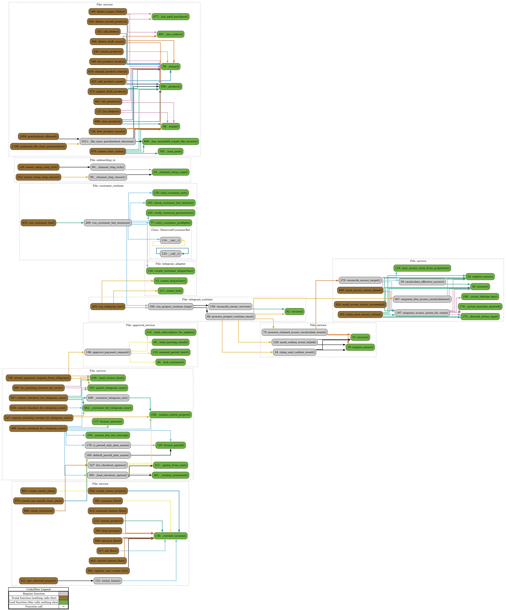
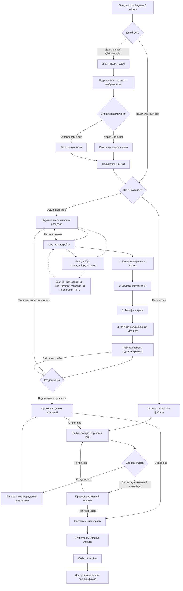

# Telegram Membership SaaS

SaaS-платформа для монетизации Telegram-каналов и групп.

**Режим владельца платформы:** закрытая защищённая панель оператора ViMi Pay,
отдельная от административных панелей подключённых ботов. Разграничение
полномочий описано в [docs/PLATFORM_OWNER.md](docs/PLATFORM_OWNER.md).
Реальный доступ определяется серверными правами; одно только наличие кода
не подтверждает активность режима в конкретном окружении.

**Учёт использования:** неизменяемая история подключений и удалений
ботов, тарифов, подписок, подтверждённых платежей и покупателей для будущей
монетизации ViMi Pay. [Описание учёта](docs/PLATFORM_USAGE_METERING.md).
Реализовано ядро коммерческого биллинга платформы. **Фактические переключатели
монетизации на рабочей ВМ не подтверждены данным репозиторием**;
проверяйте их через авторизованную read-only сводку, а не по старым README.

**Продуктовая модель v2.0:** центральный `@vimipay_bot` подключает и обслуживает боты; администратор настраивает каналы, тарифы и оплату **в собственном подключённом боте**, в котором покупатели также совершают покупки. В центральном для Platform Owner предусмотрен отдельный глобальный режим аналитики. См. [утверждённый контракт](docs/VIMI_PAY_V2.md).

Цель: дать владельцу канала простой способ создавать тарифы, задавать валюты и цены, настраивать способы оплаты, вручную подтверждать поступление денег и автоматически управлять выдачей/продлением/отзывом доступа.

## Статус

**Состояние на 2026-11-15:** функциональная многоботная staging-система
(последний наблюдаемый снимок: 51 подключённый бот, 51 работающий),
с кодом подписок, файлов, Stars, Crypto Pay, оповещений и SaaS-счетов.
CI #1721: 1 190 тестов прошли; staging #60 развернул коммит `12427b17`.
**Готовность отдельного production, резервного восстановления и публичной рекламы
не доказана.** См. [актуальный реестр готовности](docs/LAUNCH_READINESS_2026_11_15.md).

## Основной сценарий MVP

1. Владелец подключает токен своего Telegram-бота в центральном ViMi Pay и переходит в него.
2. В собственном боте через админ-панель подключает Telegram-канал или группу.
3. Создаёт тариф.
4. Добавляет валюты и цены.
5. Создаёт полуавтоматические способы оплаты.
6. Покупатель выбирает тариф, валюту и способ оплаты.
7. Покупатель переводит деньги владельцу и отправляет подтверждение в Telegram.
8. Бот пересылает подтверждение администратору.
9. Администратор проверяет реальное поступление денег в банке.
10. Администратор нажимает «Подтвердить» или «Отклонить».
11. После подтверждения система создаёт Payment, активирует/продлевает Subscription, создаёт Entitlement Grants и автоматически выдаёт доступ.
12. После окончания срока система пересчитывает Effective Access и отзывает доступ только если активных оснований больше нет.

## Ключевые принципы

- Все валюты тарифа равноправны. Нет основной валюты и основной цены.
- Currency и Payment Method — разные сущности.
- Payment Request, Payment, Subscription, Entitlement и Access не смешиваются.
- Полуавтоматическая оплата в ядре называется `ManualSettlement`.
- Чеки/скриншоты не хранятся и не анализируются нашей системой: Telegram только доставляет их администратору.
- Новый проект по умолчанию использует `Europe/Moscow`; время в БД хранится в UTC.
- Архитектура — modular monolith, без преждевременных микросервисов.
- PostgreSQL — источник бизнес-состояния.
- Multi-tenant isolation, idempotency, atomic approval, audit log, transactional outbox и reconciliation закладываются с первого production-кода.

## Документация

**Текущая коммерческая модель:** [docs/PLATFORM_COMMERCIAL_BILLING_V2.md](docs/PLATFORM_COMMERCIAL_BILLING_V2.md) — 72 часа на первый бот, отдельные счета на ботов, 150 ₽ или $5 для будущих счетов (исторические $3 сохраняются) и 5% с подтверждённых продаж; более поздний #162 изменил политику просроченной задолженности на сеть владельца. [Старый v1](docs/PLATFORM_COMMERCIAL_BILLING.md) сохранён как архив. Реальные флаги активации требуется проверить в БД.

Новый разработчик или новый чат должен читать документы в таком порядке:

- [**Актуальная матрица готовности к продажам (2026-11-15)**](docs/LAUNCH_READINESS_2026_11_15.md) — верифицированное, предположения, незакрытые релизные и инфраструктурные вопросы.

0. [`docs/VIMI_PAY_V2.md`](docs/VIMI_PAY_V2.md) — утверждённые роли и границы между ботами.
1. [`docs/PROJECT_CONTEXT.md`](docs/PROJECT_CONTEXT.md) — обязательный контекст проекта и правила работы.
2. [`docs/CONCEPT.md`](docs/CONCEPT.md) — полная продуктовая концепция.
3. [`docs/ARCHITECTURE.md`](docs/ARCHITECTURE.md) — архитектурные границы и доменная модель.
4. [`docs/DEVELOPMENT_WORKFLOW.md`](docs/DEVELOPMENT_WORKFLOW.md) — порядок разработки GitHub → PR → CI → review → staging → production.
5. [`docs/SECURITY.md`](docs/SECURITY.md) — обязательные требования безопасности.

## Публичный репозиторий

Репозиторий публичный. В него запрещено коммитить:

- Telegram bot tokens;
- API keys;
- пароли;
- `.env`;
- банковские реквизиты владельцев;
- реальные пользовательские данные;
- секреты VM/SSH;
- приватные адреса инфраструктуры;
- любые production credentials.

Все примеры должны использовать фиктивные данные.

## Предварительный стек

- Python 3.12+
- aiogram 3
- FastAPI
- PostgreSQL
- SQLAlchemy 2
- Alembic
- Pydantic
- pytest
- Docker

Дополнительные компоненты добавляются только при реальной необходимости.

## Архитектура и схема алгоритмов

При каждом PR в `main` запускается
[`architecture-and-quality.yml`](.github/workflows/architecture-and-quality.yml).
Он проверяет Python-код инструментами **Ruff**, **mypy --strict**,
**Bandit**, **Radon**, строит через **code2flow + Graphviz**
граф обнаруженных вызовов и обновляет PNG в ветке PR.

**Охват PNG:** действующие модули `src/telegram_membership_saas/`:
центральный и клиентский runtime, Telegram-адаптер, мастер владельца,
коммерческая обработка, оплаты, файлы, подписочный доступ и outbox.
Схема представляет **статически обнаруженные связи функций**.
Динамически зарегистрированные aiogram-обработчики, callback-переходы
и бизнес-состояния не всегда видны code2flow; их логика описана
ниже и в [правилах UX](docs/UX_NAVIGATION.md).
Граф вызовов не является точной UML-диаграммой исполнения.

### Навигация кнопок и переходы состояний (Mermaid)

**Реализация состояния:** для административного мастера используется
персистентная таблица `owner_setup_sessions`, а не обязательный
`aiogram.fsm.FSMContext`. В ней хранятся шаг, область бота,
ожидаемый идентификатор сообщения, поколение сценария и срок действия;
обработчик должен проверять эти значения при вводе и нажатии кнопок.
Кнопка **«Назад»** возвращает к предыдущему экрану внутри разрешённого
сценария; **«Отмена»** выходит из мастера без автоматического изменения
подтверждённых покупок, инвойсов и предоставленного доступа.

**Результаты PR:** в комментарии публикуется одна обновляемая сводка
по Bandit и Radon; полные отчёты приложены как
`vimi-quality-reports` в GitHub Actions. Анализ mypy на первом этапе
носит диагностический характер, чтобы уже существующие ошибки типов
не заблокировали все изменения. Проверка Ruff продолжает блокировать
несоответствия через действующий основной CI. Для PR из форков
доступен только отчёт-артефакт: workflow не имеет права изменять
чужую ветку или публиковать комментарии с повышенными правами.
